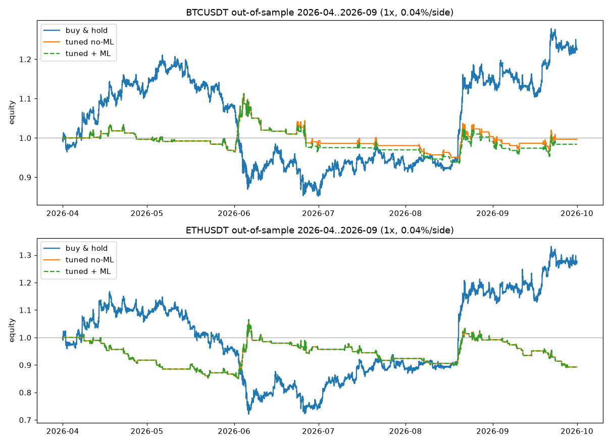

# NEXUS Backtest v2: fixes, fewer trades, honest out-of-sample

Reproduce with `python3 backtest.py`. Raw output is in `backtest_results.json`, the chart in `backtest_equity.png`.

## Protocol

| Item | Value |
|---|---|
| Data | Binance USD-M futures klines (data.binance.vision), 15m / 1h / 4h |
| Symbols | BTCUSDT, ETHUSDT |
| ML training for tuning | 2025-08 → 2025-11 |
| **Tuning window** (parameters picked here only) | 2025-12-01 → 2026-03-31 |
| ML training for OOS | 2025-12 → 2026-03 (retrained, strictly before OOS) |
| **Out-of-sample window** (evaluated once) | 2026-04-01 → 2026-09-30 |
| Execution | Signal at a 15m close, entry at the next bar's open. Exit at SL/TP (ATR multiples) or max hold. SL is assumed if both are hit in one bar |
| Sizing / fees | 1 position per symbol, 100% equity, **1x**, 0.04% taker per side. Funding and slippage not modelled |
| No lookahead | Only closed 15m/1h/4h bars are visible at each decision |

### Parameter search (26 configs total)
- 24 no-ML configs: `min_score` {55, 65, 75} × full 4h/1h/15m trend alignment {off, on} × cooldown after a trade {0, 32 bars} × exit {SL 1.5/TP 3.0 ATR with 24h max hold, SL 2.0/TP 4.5 ATR with 48h max hold}
- 2 ML confidence thresholds {0.55, 0.45}, tested on top of the chosen config
- Objective: sum of BTC+ETH net return on the tuning window, with at least 30 trades. 11 of the 24 configs were positive there.
- **Chosen:** `min_score 65`, full TF alignment **on**, cooldown 0, SL 2.0 ATR / TP 4.5 ATR / max hold 48h, ML confidence 0.55
- Tuning-window result: BTC +4.2% (57 trades, PF 1.14), ETH +14.8% (83 trades, PF 1.25). These numbers are in-sample and optimistic by construction.

## Out-of-sample results (Apr–Sep 2026)

| Symbol | Strategy | Trades | Win rate | Net return | Gross (pre-fee) | Max DD | PF | Sharpe |
|---|---|---|---|---|---|---|---|---|
| BTCUSDT | v1 (old defaults) | 579 | 33.9% | −30.9% | +9.8% | −31.0% | 0.83 | −2.76 |
| BTCUSDT | **v2 tuned, no ML** | 125 | 32.0% | **−0.3%** | +10.1% | −15.1% | 1.01 | 0.06 |
| BTCUSDT | v2 tuned + ML | 125 | 31.2% | −1.6% | +8.7% | −16.2% | 0.99 | −0.08 |
| BTCUSDT | Buy & hold | – | – | +22.4% | – | −29.7% | – | 1.27 |
| ETHUSDT | v1 (old defaults) | 626 | 35.1% | −24.1% | +25.3% | −31.9% | 0.91 | −1.20 |
| ETHUSDT | **v2 tuned, no ML** | 139 | 30.2% | **−10.7%** | −0.2% | −16.4% | 0.89 | −0.84 |
| ETHUSDT | v2 tuned + ML | 139 | 30.2% | −10.7% | −0.2% | −16.4% | 0.89 | −0.84 |
| ETHUSDT | Buy & hold | – | – | +27.5% | – | −38.2% | – | 1.11 |

The v1 rows come from the v2 simulator with the old defaults. ETH shows 626 trades here versus 629 in the first report because of a small end-of-window handling difference.

## Verdict

**Out-of-sample is still not profitable after fees.** Cutting trades by about 78% roughly halved drawdowns and brought BTC to break-even, but ETH lost 10.7%. Both lag buy & hold by a wide margin. The tuning-window profits did not hold up out of sample, which is the classic sign that the edge is small or noise.

## Code changes in this version

1. `ml/features.py`: fixed the crash where `l5.details["vwap"]` (a dict) was compared with `0`. It now reads `["value"]`.
2. Train/inference mismatch: `layer7_ml` now passes candle-only features by default (`ML_USE_LAYER_FEATURES = False`), which is exactly what `ml/trainer.py` trains on. The trainer now extracts features on a rolling `ML_FEATURE_WINDOW = 250` bars, the same window live inference sees, instead of the O(n²) growing prefix.
3. `ml/predictor.py`: agree/disagree thresholds now follow `config.ML_MIN_CONFIDENCE` (+0.10 for the strong level). The defaults are unchanged.
4. `analyze.py`: `MIN_SCORE` is now actually enforced. Previously grade "C" (40–54) still produced a signal. An optional full-timeframe alignment filter was added.
5. `scoring/nexus_score.py`: SL and TP2 distances come from `config.SL_ATR_MULT` / `TP_ATR_MULT`.
6. `config.py`: the tuned values are `MIN_SCORE=65`, `REQUIRE_FULL_TF_ALIGNMENT=True`, `SL_ATR_MULT=2.0`, `TP_ATR_MULT=4.5`, `MAX_HOLD_BARS=192`.

## Caveats

- **ML still barely matters.** It now runs without errors, but the RF+GB model's directional probability rarely clears 0.55. A non-zero delta happened on only 0.35% (BTC) and 0.20% (ETH) of OOS bars, and it slightly hurt BTC. The 5-bar labels don't match the 2–48h trade horizon, which is a likely reason. The LSTM was not used because it is too slow on CPU.
- Layer 4 (order flow) is neutral in the backtest because no historical order book, OI, funding or long/short data was available.
- `SIGNAL_COOLDOWN_BARS` and `MAX_HOLD_BARS` are used by the backtest, but the live scanner doesn't apply them yet.
- Funding and slippage would lower results further. This covers one 6-month period and two symbols only.
- 26 configs were tried, so even the tuning-window numbers carry selection bias.
